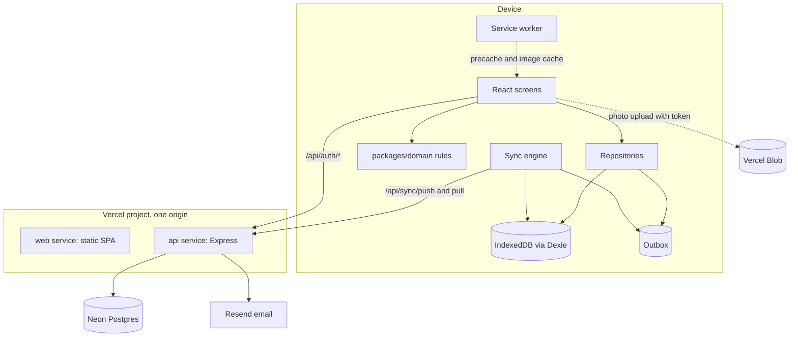
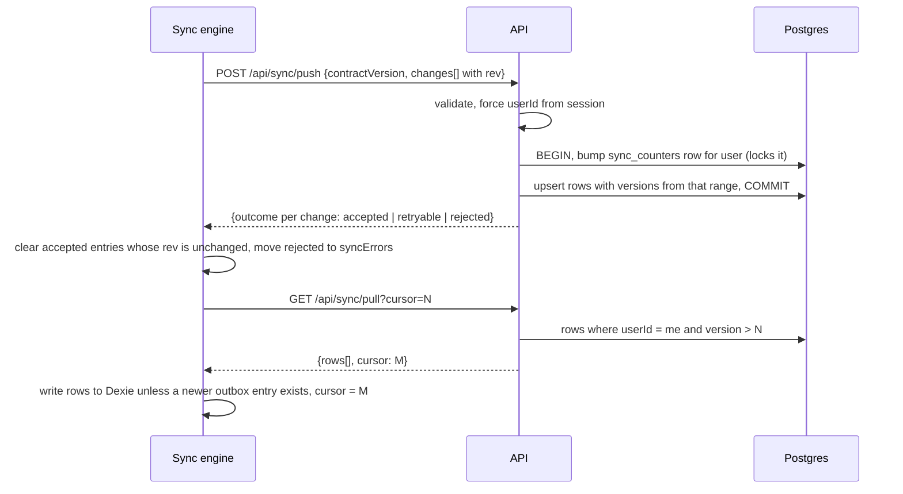
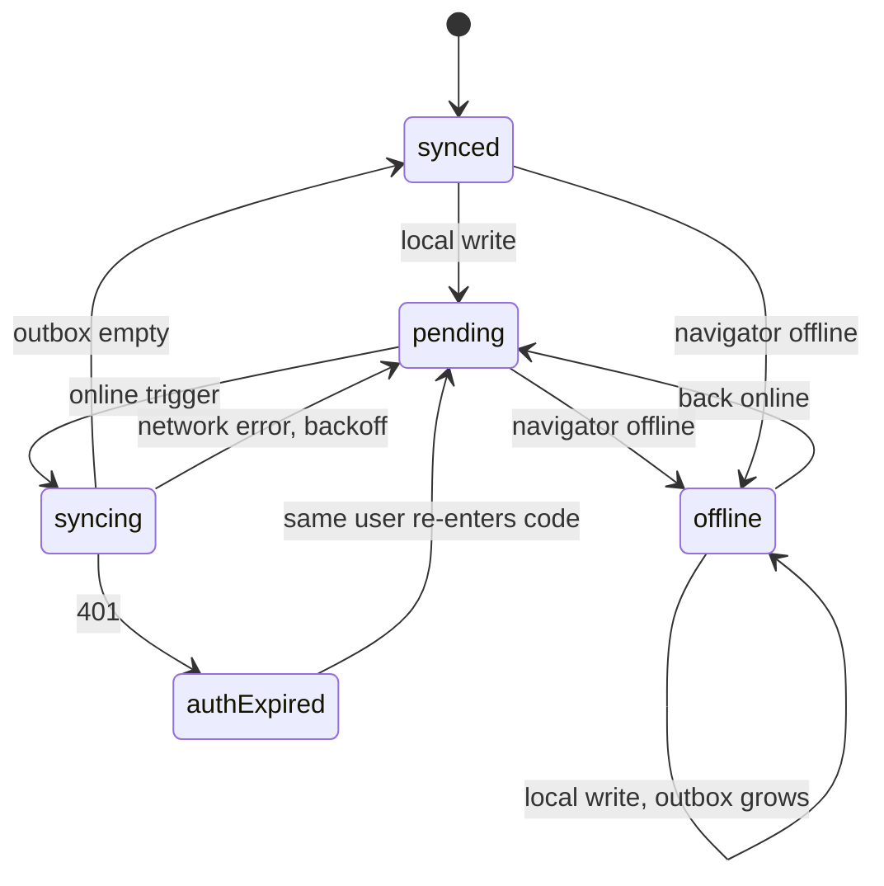
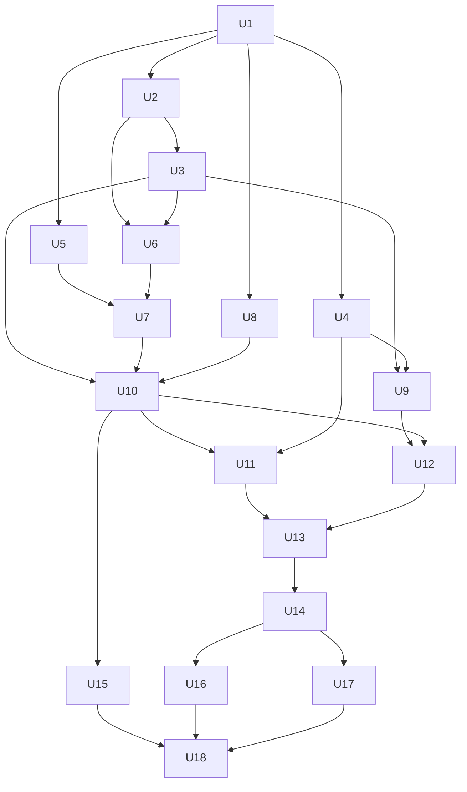

# Gym PWA vistas MVP y v1.1 - Plan

## Goal Capsule

- **Objective:** a person can install the app on their phone, sign in with a 6-digit email code, create routines and log full workouts with no signal, and find all their history and progress intact on any device after it syncs. The screens VA and V0–V12 behave exactly as `docs/spec/gym-pwa-spec.md` describes.
- **Means:** a local-first React SPA backed by a thin Express API on Neon Postgres, shipped as one Vercel deployment (KTD1, KTD4, KTD5).
- **Product authority:** the Product Contract below, then `docs/spec/gym-pwa-spec.md` for per-screen detail. Designs in `docs/designs/` govern look and layout only; they never override behavior. V13–V16 are context, not active scope.
- **Stop conditions:** stop and ask if a design in `docs/designs/` contradicts a requirement, if the free-exercise-db image license turns out to forbid this use, or if Vercel Services cannot serve the SPA and the API from one origin.
- **Execution profile:** greenfield monorepo; domain rules and sync are test-first; screens are built against the spec with base shadcn components and restyled when designs land.
- **Who finishes:** `ce-work` executes unit by unit; the user owns the Vercel, Neon and Resend accounts and the sending domain (see Risks & Dependencies).

---

## Product Contract

Product Contract preservation: changed: R3, AE5 — sign-in with Google replaced by a 6-digit code sent by email (user decision during planning: a magic link does not reach an installed iOS PWA). Outstanding Questions resolved in place by the Planning Contract.

### Summary

Una PWA de entreno que funciona sin conexión y sincroniza con la nube, con acceso obligatorio mediante un código de 6 dígitos enviado por email y una cuenta aislada por persona. La especificación queda pulida para V0–V12 más una pantalla de acceso, con las reglas de comportamiento cerradas para que el diseño no tenga que suponer nada.

### Problem Frame

La especificación original describía bien la intención y la inspiración, pero dejaba sin decidir los comportamientos que más pesan en el diseño de V5, que es la pantalla más usada. No decía cómo se emparejan las filas de "Anterior" cuando cambia el número de series, qué muestra el chip "En otra rutina", cómo se comportan las superseries ni cuándo salta un PR. Tampoco decidía qué cuenta como volumen en los ejercicios de peso corporal.

Además había contradicciones: hablaba de 12 vistas cuando son 13, el brief priorizaba vistas de v1.1 por delante de vistas del MVP, había RPE por serie y esfuerzo por sesión a la vez, y el tipo de registro "tiempo" existía en el modelo pero no en la tabla de series. Por último, guardar los datos solo en el móvil arriesgaba perder todo el historial al cambiar de teléfono.

### Key Decisions

- **Alcance de diseño: MVP + v1.1.** El brief del diseñador ya incluía V9–V11 y las métricas que las alimentan. Governs R1, R2. (session-settled: user-approved — chosen over solo MVP: el brief ya incluía V9–V11 y conviene cerrar sus métricas a la vez)
- **Sync en la nube desde el MVP.** Cambiar de móvil o que el navegador borre el almacenamiento no debe costar el historial. Governs R3, R5, R6, R7. (session-settled: user-directed — chosen over local + export manual con recordatorio: evitar perder el historial al cambiar de dispositivo)
- **Login obligatorio al abrir.** Siempre hay usuario, lo que simplifica el modelo; la primera apertura necesita señal. Governs R3. (session-settled: user-directed — chosen over login opcional tras el onboarding: siempre hay usuario identificado)
- **Acceso con código de 6 dígitos por email.** Funciona igual en navegador, Android y la app instalada en iPhone, donde un enlace se abriría en Safari sin iniciar sesión en la app. Governs R3. (session-settled: user-directed — chosen over Google y magic link: un enlace no inicia sesión dentro de la PWA instalada en iOS)
- **Registro abierto con datos aislados por cuenta.** Aunque la uses solo tú, cualquiera puede crear su cuenta. Governs R4, R16. (session-settled: user-directed — chosen over lista blanca de una sola cuenta: funciona como multiusuario real)
- **Carpetas con orden de ciclo opcional.** Una carpeta normal agrupa; una carpeta marcada como ciclo define la secuencia A→B→C. Governs R9, R10. (session-settled: user-approved — chosen over solo carpetas, programas obligatorios o quitar "Toca hoy": sugerencia exacta sin obligar a usar programas)
- **Tres tipos de registro en el MVP.** Peso + reps, reps con lastre opcional y tiempo cubren pesas, peso corporal e isométricos. Governs R13, R14. (session-settled: user-approved — chosen over los cuatro tipos o solo peso + reps: cubre plancha y dominadas sin diseñar cardio)
- **"Anterior" se empareja por posición.** Más simple de entender; se acepta que un calentamiento extra pueda rellenarse con el peso de trabajo. Governs R18. (session-settled: user-directed — chosen over emparejar por tipo y posición: preferencia por la regla fila con fila)
- **Chip "En otra rutina" con reciente y mejor.** El chip muestra lo reciente y al tocarlo se despliega también el techo histórico. Governs R19. (session-settled: user-directed — chosen over mostrar solo la más reciente: ver estado actual y techo sin salir de V5)
- **Superseries sin lógica de descanso.** Cada ✓ arranca su descanso; la superserie solo agrupa. Governs R20. (session-settled: user-directed — chosen over descanso solo al cerrar la ronda: menos reglas y control manual)
- **Solo RPE por serie.** Se elimina el esfuerzo global 1–10 de V7. Governs R21, R25, R28. (session-settled: user-directed — chosen over mantener ambos con RPE oculto: una sola medida de esfuerzo)
- **PRs desde la segunda sesión del ejercicio.** La primera sesión fija la marca base sin celebrar. Governs R22. (session-settled: user-approved — chosen over badge siempre: evita una lluvia de PRs al empezar)
- **Peso corporal con lastre opcional.** El volumen cuenta solo el lastre, y por eso el mapa de calor pasa a medir series y no volumen. Governs R23, R27. (session-settled: user-approved — chosen over sumar el peso corporal o excluirlos del volumen: no exige registrar el peso corporal)
- **"Actualizar rutina" incluye pesos objetivo.** Governs R24. (session-settled: user-approved — chosen over solo estructura o no preguntar nunca: la plantilla refleja la progresión)
- **Catálogo de base abierta con imágenes más ejercicios propios con foto.** Governs R15, R16, R17. (session-settled: user-directed — chosen over semilla curada de unos 100 sin fotos: catálogo amplio y con imágenes)
- **Archivar oculta; Eliminar conserva el historial.** Governs R11, R12. (session-settled: user-approved — chosen over borrar las sesiones o quitar Eliminar: el historial nunca se pierde por limpiar plantillas)

### Actors

- A1. Usuario: persona que entrena, crea rutinas y revisa su progreso. Es el único actor humano; cada cuenta es independiente.
- A2. Servicio de sincronización: recibe y devuelve los cambios de la cuenta cuando hay conexión.

### Requirements

**Alcance y brief**

- R1. El diseño cubre V0–V12 más la pantalla de acceso VA; V13–V16 quedan como contexto sin diseñar.
- R2. El brief del diseñador lista las pantallas en este orden: V5, V6, V1, V3 y V4, V7, VA y V0, V2 y V8, V12, V9, V10 y V11. Pide para cada pantalla los estados normal, vacío, datos largos y, donde aplique, sin conexión.

**Cuenta y sincronización**

- R3. VA (email → código de 6 dígitos) aparece antes de V0 y la primera apertura requiere conexión; sin señal muestra un estado "Necesitas conexión para entrar la primera vez".
- R4. Cualquier persona con email puede registrarse y cada cuenta ve solo sus propios datos.
- R5. Tras el primer acceso, ninguna sesión caducada ni falta de señal bloquea registrar un entreno; los cambios se guardan en el dispositivo y se sincronizan al volver la conexión.
- R6. Un indicador global discreto muestra el estado de sincronización: sincronizado, pendiente o sin conexión. V12 muestra el detalle con la hora de la última sincronización.
- R7. Si dos dispositivos de la misma cuenta editan el mismo dato, gana la última escritura y no existe pantalla de conflictos.
- R8. V12 mantiene exportar e importar (JSON y CSV) y cerrar sesión.

**Rutinas y carpetas**

- R9. Una carpeta puede marcarse como "programa en ciclo" y definir el orden de sus rutinas.
- R10. "Toca hoy" sugiere la siguiente rutina del ciclo entrenado más recientemente; si no hay carpetas en ciclo, sugiere la rutina activa que más días lleva sin hacerse.
- R11. Archivar quita la rutina del feed y de "Toca hoy"; se recupera desde la sección "Rutinas archivadas".
- R12. Eliminar borra la plantilla, pero sus sesiones siguen en Historial y Progreso con el nombre guardado y la etiqueta "(eliminada)".

**Ejercicios y catálogo**

- R13. El MVP soporta tres tipos de registro: peso + reps, reps con lastre opcional y tiempo.
- R14. La tabla de series de V5 adapta sus columnas al tipo: `Serie | Anterior | kg | Reps | ✓`, `Serie | Anterior | +kg | Reps | ✓` o `Serie | Anterior | Tiempo | ✓`, más RPE según R21.
- R15. El catálogo inicial proviene de una base abierta con imágenes, y el usuario puede crear ejercicios propios con la misma estructura y una foto propia.
- R16. Los ejercicios personalizados y sus fotos son privados de la cuenta que los crea.
- R17. Catálogo y personalizados usan la misma lista fija de músculos, que es la que pinta el mapa muscular.

**Entreno activo (V5 y V6)**

- R18. "Anterior" empareja la fila N de hoy con la fila N de la última sesión de esta rutina, sin importar el tipo de serie; las filas sin pareja muestran "—" y se precargan con la última fila del ejercicio.
- R19. El chip "En otra rutina" muestra la sesión más reciente del ejercicio fuera de esta rutina (su mejor serie); al tocarlo se despliega también la mejor marca histórica fuera de la rutina (mayor e1RM) y un enlace a V11. Si no hay registros fuera de la rutina, el chip no aparece.
- R20. Las superseries agrupan visualmente los ejercicios; cada ✓ arranca el descanso de su ejercicio y "Siguiente" en V6 sigue la alternancia A1 → B1 → A2.
- R21. RPE (1–10) es un campo opcional por serie que no se precarga con el valor anterior.
- R22. La primera sesión de un ejercicio fija sus marcas sin mostrar badge; desde la segunda, el badge PR aparece al superar una marca, con un máximo de un badge por serie.
- R23. En peso corporal el volumen es lastre × reps y los PRs se miden por reps; en tiempo, el PR es la mayor duración.

**Finalizar y sesiones**

- R24. V7 pregunta "¿Actualizar la rutina?" si cambiaron ejercicios, número o tipo de series, o si el peso hecho difiere del objetivo. Muestra la lista de cambios y ofrece Sí o Solo esta vez.
- R25. Las sensaciones de V7 son energía 1–5 y etiquetas rápidas; no hay esfuerzo global.
- R26. Editar o eliminar una sesión desde V8 recalcula PRs y métricas.

**Historial y progreso**

- R27. La intensidad del mapa de calor de V9 depende de las series completadas del día: 4 niveles más vacío.
- R28. La "sensación media" de V2 y V10 muestra por separado la energía media y el RPE medio.

### Key Flows

- F1. Primera apertura
  - **Trigger:** el usuario abre la app por primera vez.
  - **Steps:** VA → escribe su email → recibe y teclea el código → V0 en 3 pasos → V1 vacío.
  - **Covered by:** R3, R4
- F2. Entreno sin señal
  - **Trigger:** el usuario inicia una rutina en un gym sin cobertura.
  - **Steps:** V1 → ▶ Iniciar → V5 registra series y el indicador muestra "sin conexión" con los cambios pendientes → V7 guarda → al volver la señal el indicador pasa a "pendiente", sincroniza y queda en "sincronizado".
  - **Covered by:** R5, R6
- F3. Finalizar con cambios
  - **Trigger:** el usuario añadió una serie y subió el peso en una sesión de rutina.
  - **Steps:** V5 → Finalizar → V7 muestra el resumen y la lista de cambios → Sí actualiza la plantilla, Solo esta vez la deja intacta.
  - **Covered by:** R24

### Acceptance Examples

- AE1. **Covers R18.** **Given** la sesión pasada tuvo 4 filas y hoy hay 6, **when** se abre V5, **then** las filas 1–4 muestran su "Anterior" y las filas 5–6 muestran "—", precargadas con la fila 4.
- AE2. **Covers R18.** **Given** hoy hay un calentamiento extra en la fila 2, **when** se abre V5, **then** la fila 2 muestra y precarga el peso de la fila 2 pasada, aunque fuera una serie de trabajo.
- AE3. **Covers R10.** **Given** la carpeta "PPL" es un ciclo Push → Pull → Legs y la última sesión fue Pull, **when** se abre V1, **then** "Toca hoy" sugiere Legs.
- AE4. **Covers R22.** **Given** es la primera vez que se hace sentadilla, **when** se marca ✓ en 100 × 5, **then** no aparece el badge; en la siguiente sesión, 102,5 × 5 sí lo muestra.
- AE5. **Covers R5.** **Given** la sesión caducó y no hay señal, **when** el usuario inicia y guarda un entreno, **then** todo se registra sin pedir el código y se sincroniza tras volver a acceder con conexión.
- AE6. **Covers R20.** **Given** press banca (A) y remo (B) están en superserie, **when** se marca ✓ en A1, **then** arranca el descanso de A y "Siguiente" muestra B1.
- AE7. **Covers R12.** **Given** se elimina la rutina "Pierna B", **when** se abre V9, **then** sus sesiones aparecen como "Pierna B (eliminada)".
- AE8. **Covers R19.** **Given** la sentadilla no se ha hecho fuera de esta rutina, **when** se abre V5, **then** el chip no aparece.

### Scope Boundaries

**Diferido**

- Registro por distancia y cardio.
- V13–V16: cuerpo, fotos de progreso, nutrición y dashboard unificado.
- Progresión automática de peso y sugerencias de carga.
- Límites de cuota o moderación para cuentas ajenas que se registren.
- Pantalla de resolución de conflictos de sincronización.
- Acceso con Google u otros proveedores sociales.

**Fuera de la identidad del producto**

- Funciones sociales: compartir rutinas entre cuentas, feed o amigos. La imagen de celebración de V7 sí se puede compartir.

### Dependencies / Assumptions

- Se asume que la licencia de las imágenes de free-exercise-db permite este uso; el repositorio es Unlicense, pero la licencia de las imágenes no está confirmada.
- Enviar códigos a cualquier email requiere un dominio propio verificado en el servicio de email.

### Sources / Research

- `docs/spec/gym-pwa-spec.md`: especificación de vistas, flujos y datos, actualizada con estas decisiones.
- `docs/designs/`: carpeta donde se guardan los diseños por vista.

---

## Planning Contract

### Key Technical Decisions

- KTD1. **React + Vite SPA and an Express API in a pnpm monorepo, deployed as one Vercel project with Vercel Services.** The app reads from the device, not the server, so server rendering adds nothing and makes offline routing harder; one origin keeps the session cookie first-party. Public ingress sends `/api/*` to the API service and everything else to the SPA. (session-settled: user-approved — chosen over Next.js: the app is local-first, so a static SPA precaches cleanly and every deep link works offline)
- KTD2. **Neon Postgres with Drizzle ORM** using the Neon serverless Pool (WebSocket) driver from the API service, because sync push needs interactive transactions (KTD5). Drizzle gives typed schema, SQL-close queries and versioned migrations, and it has a first-class Better Auth adapter. Prisma was the alternative; its heavier client and generated engine add cold-start cost on serverless functions for no benefit at this schema size. The user chose Neon and Vercel.
- KTD3. **Better Auth with its email-OTP plugin and the Drizzle adapter, emails sent with Resend.** Instantiates the Product Key Decision on R3, R4. Sessions use a long-lived, sliding, httpOnly cookie on the shared origin. Sign-up is implicit on first verified code. Rate limiting uses Better Auth's database storage, not its in-memory default, so limits hold across serverless instances. Sessions last 60 days and are refreshed daily by the sync engine (U3, U7). (session-settled: user-directed — chosen over Google OAuth and magic link: a link opens Safari and never signs in the installed iOS PWA)
- KTD4. **IndexedDB through Dexie is the UI's only data source.** Screens read via live queries and write through repository functions; no screen calls the API for data. The server is a sync peer, not a backend the UI depends on. Governs R5.
- KTD5. **Sync is a push-outbox plus versioned-pull protocol, last write wins by server receipt order.** Governs R5, R6, R7.
  1. Every local mutation writes the row and its outbox entry in one Dexie transaction. Each entry carries a local revision that increases on every replace. After a push, an entry is cleared only if its revision still equals the one that was sent, so edits made during an in-flight push are never dropped.
  2. Push sends batches of full rows plus the client's contract version. Each push runs in one interactive transaction that first increments the user's row in `sync_counters` (which locks it) and stamps the upserted rows from that range. Versions for one user therefore commit in order, and a pull cursor can never pass a version that has not committed yet. A global sequence was rejected because `nextval` order is not commit order, so concurrent pushes from two devices could be skipped.
  3. The push response gives each change an outcome: accepted, retryable, or rejected with a reason. Rejected entries move out of the outbox into a local `syncErrors` store shown in V12, so the indicator can still reach "sincronizado". A contract version below the server minimum returns a "client outdated" response that triggers the update toast.
  4. Pull returns the user's rows with `version` greater than the client cursor. Deletes are tombstones (`deletedAt`).
- KTD6. **Client-generated UUIDv7 ids for every syncable row.** Rows can be created offline and referenced before the server has seen them; v7 keeps index locality in Postgres.
- KTD7. **Derived data is never stored or synced.** PRs, volume, e1RM, streaks and heatmap levels are computed on the device from workouts and sets; the spec's `PersonalRecord` table is dropped. Editing or deleting a session (R26) needs no reconciliation, and two devices cannot disagree about records.
- KTD8. **All product rules live in `packages/domain` as pure TypeScript with no framework, storage or clock dependency.** It owns "Anterior" pairing, the other-routine chip, superset "next", PR detection, volume and e1RM, "Toca hoy", streak, adherence, heatmap levels, the routine-diff for "Actualizar rutina", sensation averages and unit conversion. Built test-first.
- KTD9. **The active workout is a normal `Workout` row with `status: active` in Dexie, not a separate persisted store.** Interrupted-workout recovery (spec F5) then reads the same data as everything else. Zustand holds only ephemeral UI state such as the open sheet and focused row. Rest timing stores `restEndsAt` and derives the remaining time from it.
- KTD10. **Canonical units: kg for weight and seconds for duration.** Conversion to lb happens only at display and input.
- KTD11. **Exercise catalog ships as a versioned static JSON asset; images live on Vercel Blob.** The catalog is identical for all users, so it does not belong in the database or the sync stream. Only custom exercises sync. The service worker caches catalog images on first view.
- KTD12. **Custom exercise photos: the client compresses to WebP (max 1080 px, JPEG fallback where the browser cannot encode WebP) and uploads directly to Vercel Blob with a short-lived token from the API.** The token allows only image types, at most 2 MB, and one server-chosen path under the user's prefix with a random suffix. Uploads made offline wait in the outbox and the exercise shows the equipment icon meanwhile. How the photo is kept private (R16) is an open decision (see Open Questions).
- KTD13. **PWA via vite-plugin-pwa in `injectManifest` mode.** A custom service worker precaches the app shell, runtime-caches catalog images, and shows the rest-end notification. React Router's SPA fallback plus the Vercel Services rewrite to `index.html` makes every route work offline.
- KTD14. **UI built with Tailwind CSS v4 and shadcn/ui, with theme tokens as CSS variables (dark by default).** Designs from `docs/designs/` restyle tokens and components later without touching feature logic.
- KTD15. **Testing: Vitest everywhere, `fake-indexeddb` for local data, PGlite (in-process Postgres) for API and Drizzle tests, Playwright for end-to-end flows including forced-offline runs.** Unit and integration tests need no Neon database. Migration checks (U2) and preview end-to-end runs (U18) use Neon branches.
- KTD16. **UI conventions apply to every screen before designs land.** Touch targets are at least 48 px. Completed state uses the ✓ as well as color. Every swipe or drag action has a visible menu or button alternative. Live changes (rest end, sync status) are announced to screen readers. Above 480 px the app renders as one centered mobile column.

### High-Level Technical Design

Component topology. The SPA never depends on the API to render; the API is only for auth, sync and upload tokens.



Sync round trip (KTD5). Push runs before pull, so a device sees its own writes echoed back with server versions and advances its cursor past them.



Sync status shown by the global indicator (R6) and V12. AE5 describes the `authExpired` state: logging keeps working and only sync stops. The indicator shows R6's three visual states: `synced` → sincronizado, `pending` and `syncing` → pendiente, `offline` → sin conexión (with the pending count when the outbox is not empty). `authExpired` shows pendiente plus the re-auth banner.



### Output Structure

```text
apps/
  web/                      Vite + React SPA (PWA)
    src/
      app/                  router, providers, layout, tab bar, sync indicator
      features/
        auth/ onboarding/ routines/ exercises/ workout/ sessions/ history/ progress/ profile/
      data/
        db.ts               Dexie schema
        repositories/       per-entity read/write + outbox
        sync/               sync engine and status store
      pwa/                  service worker, notifications, wake lock
      ui/                   shadcn components and theme tokens
    public/catalog/         versioned exercises.es.json
  api/                      Express service
    src/
      auth/                 Better Auth instance + Resend mailer
      db/                   Drizzle schema, migrations, client
      sync/                 push and pull handlers
      uploads/              Blob token handler
packages/
  domain/                   pure rules, entity types, muscle list
  contract/                 zod schemas for API payloads, shared by web and api
scripts/catalog/            one-time import and translation of free-exercise-db
vercel.json                 Vercel Services and public rewrites
```

### Assumptions

- Node 24 LTS, pnpm workspaces, TypeScript strict across all packages.
- The user provides a Resend-verified sending domain before anyone other than the account owner can sign up; until then development uses Resend's test sender.
- The free-exercise-db Spanish translation is generated once by script, reviewed by hand, and committed; it is not translated at runtime.

### Sequencing

Foundations first (U1–U9), then MVP screens in the designer's priority order where dependencies allow (U10–U15), then v1.1 (U16–U17), then the end-to-end hardening pass (U18). U4 has no dependencies beyond U1 and can run in parallel with U2–U3.



---

## Implementation Units

| U-ID | Title | Key files | Depends on |
| --- | --- | --- | --- |
| U1 | Monorepo, tooling and Vercel Services | `package.json`, `vercel.json`, `apps/*`, `packages/*` | — |
| U2 | Server schema and migrations | `apps/api/src/db/` | U1 |
| U3 | Email-code authentication | `apps/api/src/auth/`, `apps/web/src/features/auth/` | U2 |
| U4 | Domain rules package | `packages/domain/src/` | U1 |
| U5 | Local database and outbox | `apps/web/src/data/` | U1 |
| U6 | Sync API | `apps/api/src/sync/`, `packages/contract/` | U2, U3 |
| U7 | Client sync engine and status | `apps/web/src/data/sync/` | U5, U6 |
| U8 | PWA shell and device APIs | `apps/web/src/pwa/`, `apps/web/vite.config.ts` | U1 |
| U9 | Exercise catalog and photo uploads | `scripts/catalog/`, `apps/api/src/uploads/` | U3, U4 |
| U10 | App shell, VA, V0 and navigation | `apps/web/src/app/`, `features/onboarding/` | U3, U7, U8 |
| U11 | Routines: V1, V2, V3, archived | `features/routines/` | U4, U10 |
| U12 | Exercises: V4 and custom exercises | `features/exercises/` | U9, U10 |
| U13 | Active workout: V5, V6, mini-player | `features/workout/` | U11, U12 |
| U14 | Finish and sessions: V7, V8 | `features/sessions/` | U13 |
| U15 | Profile: V12 | `features/profile/` | U10 |
| U16 | History: V9 | `features/history/` | U14 |
| U17 | Progress: V10, V11 | `features/progress/` | U14 |
| U18 | End-to-end flows and release hardening | `apps/web/e2e/` | U15, U16, U17 |

### U1. Monorepo, tooling and Vercel Services

**Goal:** a deployable skeleton where `/` serves the SPA and `/api/health` answers from Express, on one origin, in previews and production.

**Requirements:** enables all; KTD1, KTD14, KTD15.

**Dependencies:** none.

**Files:**
- `package.json`, `pnpm-workspace.yaml`, `tsconfig.base.json`, `eslint.config.js`, `.prettierrc`, `.nvmrc`
- `vercel.json`
- `apps/web/` (Vite React TS, React Router, Tailwind v4, shadcn/ui init)
- `apps/api/src/index.ts` (Express app exporting the handler, `/api/health`)
- `packages/domain/`, `packages/contract/` (empty packages wired into both apps)
- `apps/api/src/index.test.ts`

**Approach:**
1. pnpm workspaces with shared strict TS config; root scripts `lint`, `typecheck`, `test`, `test:e2e`, `build` fan out to packages.
2. `vercel.json` declares `web` (root `apps/web`) and `api` (root `apps/api`) services. Top-level rewrites send `/api/(.*)` to `api` and `/(.*)` to `web`; `web` has a service-scoped catch-all rewrite to `/index.html`.
3. Express keeps the `/api` prefix in its routes (Vercel preserves the request path).
4. Vite dev server proxies `/api` to the local Express process so local dev also runs on one origin.
5. Theme tokens as CSS variables with dark default and a light variant (KTD14).

**Patterns to follow:** Vercel Services guidance for a Vite frontend plus a backend owning `/api`.

**Test scenarios:**
- `GET /api/health` returns 200 with `{ ok: true }`.
- An unknown `/api/nope` returns a JSON 404 from Express, not the SPA's `index.html`.

**Verification:** a preview deployment serves the SPA at `/`, a deep link like `/rutinas/abc` loads the SPA, and `/api/health` returns 200.

### U2. Server schema and migrations

**Goal:** Postgres tables for every syncable entity, each scoped to a user and stamped with a sync version.

**Requirements:** R4, R7, R12, R16; KTD2, KTD5, KTD6, KTD7.

**Dependencies:** U1.

**Files:**
- `apps/api/src/db/schema.ts`, `apps/api/src/db/client.ts`, `apps/api/drizzle.config.ts`, `apps/api/drizzle/` (migrations)
- `apps/api/src/db/schema.test.ts`

**Approach:**
1. Syncable tables: `settings`, `folders` (with `isCycle`), `routines` (with `archived`, `deletedAt`), `routine_exercises`, `routine_sets`, `workouts` (with routine name copy, `status`, `energy`, `tags`, `note`; no `effort`), `workout_exercises`, `workout_sets` (with `weight` as kg or added load, `reps`, `durationSec`, `rpe`), `custom_exercises` (with `imageUrl`, `trackingType` limited to `weight_reps | reps | time`).
2. Every syncable table has `id uuid` (client-supplied), `userId`, `updatedAt` (server), `deletedAt` nullable, and `version bigint` from the user's counter (KTD5), indexed on `(userId, version)`. A `sync_counters` table holds one row per user.
3. Better Auth tables, including its rate-limit table, are generated by its CLI into the same schema.
4. Rows reference parents by id without database foreign-key constraints, so push batches can arrive in any order and one user's rows can never block or cascade into another's.
5. No `personal_records` table (KTD7). The muscle list lives in `packages/domain`, not the database.

**Test scenarios:**
- Migrations apply cleanly on an empty PGlite database.
- Two rows stamped in the same push get strictly increasing `version` values from that user's counter.
- A query helper scoped to user A never returns user B's rows for any syncable table.

**Verification:** `drizzle-kit` migration runs against a Neon branch; schema tests pass on PGlite.

### U3. Email-code authentication

**Goal:** a person enters an email, receives a 6-digit code and is signed in on that device with a long-lived session.

**Requirements:** R3, R4, F1, AE5; KTD3.

**Dependencies:** U2.

**Files:**
- `apps/api/src/auth/auth.ts`, `apps/api/src/auth/mailer.ts`, `apps/api/src/auth/require-session.ts`
- `apps/web/src/features/auth/auth-client.ts`, `apps/web/src/features/auth/AccessScreen.tsx`, `apps/web/src/features/auth/CodeStep.tsx`
- `apps/api/src/auth/auth.test.ts`, `apps/web/src/features/auth/AccessScreen.test.tsx`

**Approach:**
1. Mount Better Auth under `/api/auth/*` in Express with the email-OTP plugin, before any JSON body parser. A verified code signs in and creates the user if new.
2. Configure explicitly: code expiry 10 minutes, 5 attempts per code, rate limiting with database storage, and a custom rule on the send-code endpoint of 3 sends per email and 10 per IP per 15 minutes. Sessions last 60 days and refresh after 1 day of use.
3. The Resend mailer sends a plain Spanish email whose subject contains the code, so it is readable from the notification. In non-production environments codes are also stored in plain text so end-to-end tests can read them (U18).
4. `require-session` middleware resolves the user for every non-auth API route and returns 401 otherwise; handlers never trust a client `userId`.
5. After sign-in, the client stores the user id and email in Dexie as "last known user" (used offline by U10).
6. VA screen states per the spec: normal, sending, code entry with resend timer, wrong or expired code, too many attempts with a countdown, offline on first open.
7. Re-auth after `authExpired` opens as a dismissible sheet over the current screen with the last known user's email locked, starting at the code step. If a verified session ever belongs to a different user than the last known user, sync stops and the user is sent through the U15 sign-out path before the new account is used.

**Test scenarios:**
- A new email requests a code, submits it, and gets a session plus a new user row.
- An existing email signs in to the same user id.
- A wrong code returns an error and does not create a session.
- An expired code is rejected.
- A request without a session cookie to `/api/sync/pull` returns 401.
- VA with `navigator.onLine = false` and no stored user shows the "Necesitas conexión" state.
- A fourth code request for the same email within 15 minutes is refused with 429, also when the requests hit separate handler instances.
- A code is invalid after 5 wrong attempts, even if the right code is entered next.
- The VA too-many-attempts state shows a countdown and re-enables sending when it ends.
- Dismissing the re-auth sheet leaves the current screen and workout logging usable.
- A session belonging to a different user than the stored last known user never pushes the stored outbox and never writes pulled rows into the local data.

**Verification:** on a real iPhone with the app installed to the home screen, signing in by typing the code keeps the session after the app is closed and reopened.

**Execution note:** do the real-iPhone check as soon as this unit deploys to a preview; it is the riskiest assumption in the plan.

### U4. Domain rules package

**Goal:** every product rule exists once, as a pure function, with tests that read like the acceptance examples.

**Requirements:** R10, R14, R18, R19, R20, R22, R23, R24, R27, R28, AE1–AE4, AE6, AE8; KTD7, KTD8, KTD10.

**Dependencies:** U1.

**Files:**
- `packages/domain/src/types.ts`, `packages/domain/src/muscles.ts`
- `packages/domain/src/previous.ts`, `packages/domain/src/other-routine.ts`, `packages/domain/src/superset.ts`
- `packages/domain/src/records.ts`, `packages/domain/src/volume.ts`
- `packages/domain/src/suggest-today.ts`, `packages/domain/src/streak.ts`, `packages/domain/src/adherence.ts`, `packages/domain/src/heatmap.ts`
- `packages/domain/src/routine-diff.ts`, `packages/domain/src/sensation.ts`, `packages/domain/src/units.ts`
- a `*.test.ts` next to each module

**Approach:**
1. Inputs are plain entity arrays plus an explicit `now` and week-start setting; no I/O.
2. `previous.ts` implements R18 positional pairing with the "last row" fill for unmatched rows.
3. `records.ts` computes existing marks from history and classifies a candidate set. First-session suppression follows R22, and the badge priority (max weight > e1RM > reps at weight) follows the spec. Warm-up sets are excluded and e1RM ignores sets above 12 reps.
4. `volume.ts` follows R23: added load × reps for `reps` type, and nothing for `time`.
5. `heatmap.ts` maps completed sets per day to 4 levels plus empty (R27). Thresholds are relative to the user's own distribution, with fixed fallbacks when history is short.
6. `routine-diff.ts` produces the human-readable change list that R24 shows.

**Execution note:** implement test-first; each acceptance example in the Product Contract becomes at least one named test.

**Test scenarios:**
- Covers AE1. Previous session has 4 rows and today has 6, so rows 5–6 get `—` and prefill from row 4.
- Covers AE2. Today's extra warm-up at row 2 pairs with last session's row 2 even though that row was a working set.
- Previous pairing returns no prefills when the routine has never been done.
- Covers AE8. The other-routine chip returns null when the exercise was only done in this routine.
- The other-routine chip returns the most recent session's best set and, separately, the best e1RM set outside this routine, counting free workouts as "outside".
- Covers AE6. Superset next after A1 is B1, after B1 is A2, and after the last round it moves to the next exercise block.
- Covers AE4. The first-ever session of an exercise produces no badge, and the next session's heavier set produces a max-weight badge.
- A set that beats both max weight and e1RM produces exactly one badge, max weight.
- A warm-up set never produces a PR.
- A 15-rep set does not count toward e1RM.
- A `reps` exercise PR triggers on more reps in a set, and a heavier added load triggers the added-load record.
- A `time` exercise PR triggers on longer duration.
- Volume of a bodyweight set with no added load is 0.
- Covers AE3. With a cycle folder Push → Pull → Legs and the last session Pull, the suggestion is Legs.
- With two cycle folders, the suggestion comes from the cycle trained most recently.
- With no cycle folders, the suggestion is the non-archived routine with the oldest last workout, and never-done routines rank first.
- Archived and deleted routines are never suggested.
- The weekly streak counts consecutive weeks meeting the goal and respects a Sunday week start.
- Adherence for a 4-week period with a goal of 4 days per week and 12 trained days is 75 %.
- The heatmap gives a day with 0 completed sets the empty level and the user's top days level 4.
- The routine diff lists an added set, a removed exercise, and a target weight change from 80 to 82.5 kg, and returns empty when nothing changed.
- The routine diff ignores weight differences on warm-up rows.
- Sensation returns energy average and RPE average separately, with RPE null when no set has RPE.
- Unit conversion round-trips 100 kg to lb and back to 100 kg at display precision.

**Verification:** the domain package reaches full branch coverage on the rule modules, and every AE has a named test.

### U5. Local database and outbox

**Goal:** the device stores all user data in IndexedDB, and every write is queued for sync atomically.

**Requirements:** R5, R12; KTD4, KTD5, KTD6, KTD9.

**Dependencies:** U1.

**Files:**
- `apps/web/src/data/db.ts`
- `apps/web/src/data/repositories/` (`routines.ts`, `folders.ts`, `workouts.ts`, `exercises.ts`, `settings.ts`)
- `apps/web/src/data/outbox.ts`, `apps/web/src/data/ids.ts`
- `apps/web/src/data/repositories/*.test.ts`, `apps/web/src/data/outbox.test.ts`

**Approach:**
1. Dexie tables mirror the server entities plus `outbox`, `syncMeta` (cursor, last sync time, last known user).
2. Repositories are the only write path. Each write runs in one Dexie transaction that updates the row and appends or replaces that row's outbox entry, so there is at most one pending entry per row. Every replace increments the entry's local revision (KTD5).
3. Deletes set `deletedAt`, and reads filter tombstones out. Deleting a routine keeps its workouts and their copied name (R12).
4. Live-query hooks per screen are thin wrappers over repository reads.
5. Request `navigator.storage.persist()` after first sign-in.

**Test scenarios:**
- Creating a routine writes the row and one outbox entry in the same transaction.
- Editing the same routine twice leaves a single outbox entry holding the latest row, with its revision incremented.
- A failed transaction leaves neither the row change nor the outbox entry.
- Deleting a routine hides it from routine lists, while its workouts still read with the stored routine name and a deleted flag.
- Archiving a routine excludes it from the Inicio routine list but not from the archived list.

**Verification:** repository tests pass under `fake-indexeddb`.

### U6. Sync API

**Goal:** the server accepts a device's changes and returns everything the device has not seen yet, for the signed-in user only.

**Requirements:** R4, R5, R7, R16; KTD5, KTD7.

**Dependencies:** U2.

**Files:**
- `packages/contract/src/sync.ts` (zod schemas for push and pull payloads)
- `apps/api/src/sync/push.ts`, `apps/api/src/sync/pull.ts`, `apps/api/src/sync/router.ts`
- `apps/api/src/sync/sync.test.ts`

**Approach:**
1. `POST /api/sync/push` checks the contract version first and answers "client outdated" when it is below the minimum. It validates each change and overwrites `userId` with the session user. In one transaction it bumps the user's counter and upserts by id with versions from that range and server `updatedAt` (KTD5). It returns an outcome per change. A row id that already belongs to another user is rejected, not overwritten.
2. `GET /api/sync/pull?cursor=N&limit=500` returns the user's rows with `version > N` across all tables, ordered by version, plus the new cursor and a `hasMore` flag.
3. Payload size and batch limits keep each request well under Vercel function limits.

**Test scenarios:**
- A push of a new routine followed by a pull from cursor 0 returns that routine with a version.
- Pushing the same change twice is harmless: one row, latest content.
- Two pushes to the same row from two devices: the later push wins and a pull returns its content (R7).
- A push whose body claims another `userId` is stored under the session user.
- A push that targets a row id owned by user B is rejected and user B's row is unchanged.
- A pull for user A never includes user B's rows.
- A tombstoned row is returned by pull with `deletedAt` set.
- Pull pagination: 1,200 changed rows come back over three pages without gaps or duplicates.
- A malformed change gets a rejected outcome with a reason, and the valid changes in the same batch are accepted.
- Two concurrent pushes for one user: a pull issued after the second commits but before the first commits never moves the cursor past a version that is still uncommitted, and a later pull returns every row.
- A push with an outdated contract version returns "client outdated" and stores nothing.

**Verification:** API tests pass against PGlite.

### U7. Client sync engine and status

**Goal:** changes flow to and from the server without the user doing anything, and the status indicator always tells the truth.

**Requirements:** R5, R6, R7, F2, AE5; KTD5.

**Dependencies:** U5, U6.

**Files:**
- `apps/web/src/data/sync/engine.ts`, `apps/web/src/data/sync/status.ts`, `apps/web/src/data/sync/triggers.ts`
- `apps/web/src/data/sync/engine.test.ts`

**Approach:**
1. A sync cycle runs push and then pull, paging until `hasMore` is false. A single in-flight lock prevents overlapping cycles.
2. Triggers: app start, `online` event, visibility regained, a debounced delay after any local write, and a slow interval while online.
3. After a push, clear an accepted entry only if its revision matches the one sent. Move rejected entries to `syncErrors`. A "client outdated" response stops syncing and raises the update toast.
4. When applying pulled rows, skip any row that still has a pending outbox entry (local unsent edit wins until pushed).
5. Each online cycle starts with a session check, which also refreshes the session cookie. A session whose user differs from the last known user stops the cycle (U3 step 7).
6. Errors back off exponentially. A 401 moves status to `authExpired` and stops syncing without touching local data.
7. The status store exposes `synced | pending | syncing | offline | authExpired`, the pending count, the error count and the last sync time for the indicator and V12.

**Test scenarios:**
- Covers F2. Writes made while offline stay in the outbox with status `offline`, and on `online` a cycle pushes them and status becomes `synced`.
- A pulled row is not applied over a local row that has a pending outbox entry.
- Covers AE5. A 401 during push sets `authExpired`, keeps outbox entries, and local writes still succeed.
- A network error leaves status `pending` and schedules a retry with backoff.
- Two triggers firing together run one cycle.
- After a full cycle the cursor equals the last pulled version and a second cycle pulls nothing.
- An edit to row X made while X's push is in flight survives the push response and the following pull, and it is sent in the next cycle.
- A rejected change leaves the outbox, appears in `syncErrors`, and the status still reaches `synced`.
- A "client outdated" response stops syncing, keeps the outbox and shows the update toast.

**Verification:** engine tests pass with a fake fetch and `fake-indexeddb`; a manual check with two browsers on one account shows edits from one appearing on the other.

### U8. PWA shell and device APIs

**Goal:** the app installs, opens with no network, keeps the screen awake during workouts, and signals the end of rest.

**Requirements:** R5, spec V5 technical notes and V6; KTD13.

**Dependencies:** U1.

**Files:**
- `apps/web/vite.config.ts`, `apps/web/src/pwa/sw.ts`, `apps/web/src/pwa/register.ts`
- `apps/web/src/pwa/wake-lock.ts`, `apps/web/src/pwa/notify.ts`, `apps/web/src/pwa/install-prompt.ts`
- `apps/web/public/manifest` icons
- `apps/web/src/pwa/notify.test.ts`

**Approach:**
1. vite-plugin-pwa in `injectManifest` mode. The custom worker precaches the built shell and the catalog JSON, so the exercise list works offline right after install. Blob images use cache-first runtime caching. API requests are never cached.
2. An update-available toast lets the user reload into a new version; never auto-reload mid-workout.
3. Wake lock is acquired when V5 is visible and re-acquired on visibility regain.
4. Rest end: vibration and a short sound in the page. When the page is hidden, the service worker shows a notification at the scheduled time if it is still alive. On return, the UI recomputes from `restEndsAt` (iOS cannot guarantee background timers).
5. Install guidance and notification permission prompts for V0 step 3, with the iOS "Add to Home Screen" instructions.

**Test scenarios:**
- Remaining rest is computed from `restEndsAt` and `now`, never from tick counts: a 90 s rest checked after 200 s reports 0 and "ended".
- Notification permission denied makes rest-end fall back to vibration and sound without errors.
- Test expectation for precache wiring: covered by U18's offline end-to-end runs.

**Verification:** a production build installed on Android and iPhone opens and navigates with airplane mode on.

### U9. Exercise catalog and photo uploads

**Goal:** about 800 exercises in Spanish with images are available from the first open, and custom exercises can carry a private photo.

**Requirements:** R15, R16, R17; KTD11, KTD12.

**Dependencies:** U1.

**Files:**
- `scripts/catalog/import.ts`, `scripts/catalog/muscle-map.ts`, `scripts/catalog/translations.es.json`, `scripts/catalog/README.md`
- `apps/web/public/catalog/exercises.es.v1.json`
- `apps/api/src/uploads/token.ts`
- `apps/web/src/features/exercises/compress-image.ts`
- `scripts/catalog/muscle-map.test.ts`, `apps/api/src/uploads/token.test.ts`, `apps/web/src/features/exercises/compress-image.test.ts`

**Approach:**
1. The import script reads free-exercise-db and maps its muscles onto the fixed list in `packages/domain/src/muscles.ts`. It maps equipment onto the five spec categories and drops exercises that fit none of the three tracking types (cardio and distance). It applies the reviewed Spanish names and emits the versioned JSON.
2. Catalog images are uploaded once to a public Vercel Blob store and referenced by URL in the JSON.
3. `POST /api/uploads/token` (session required) issues a short-lived client-upload token per KTD12: image content types only, at most 2 MB, one server-chosen path under the user's prefix with a random suffix.
4. The client compresses to WebP at a max of 1080 px before upload. It checks the encoded type and re-encodes as JPEG when the browser returned something else (Safari). Offline uploads wait in the outbox as a pending blob.

**Test scenarios:**
- Every catalog exercise maps to a primary muscle from the fixed list, and the script fails loudly on an unmapped muscle.
- No catalog exercise has a tracking type outside `weight_reps | reps | time`.
- The upload token endpoint returns 401 without a session and a path under the caller's user prefix with one.
- A token rejects an HTML file and a 5 MB image.
- Image compression turns a 4000 px JPEG into a WebP no wider than 1080 px.
- When the encoder returns PNG instead of WebP, the compressor produces a JPEG.

**Verification:** the JSON loads in the app and spot-checked entries show Spanish names, correct muscles and images.

### U10. App shell, VA, V0 and navigation

**Goal:** the app opens to sign-in or straight to Inicio offline, with the tab bar, sync indicator and mini-player slot in place.

**Requirements:** R1, R3, R5, R6, F1; spec navigation architecture, VA and V0.

**Dependencies:** U3, U7, U8.

**Files:**
- `apps/web/src/app/router.tsx`, `apps/web/src/app/AppLayout.tsx`, `apps/web/src/app/TabBar.tsx`, `apps/web/src/app/SyncIndicator.tsx`, `apps/web/src/app/auth-gate.tsx`
- `apps/web/src/features/onboarding/Onboarding.tsx` (3 steps)
- `apps/web/src/app/auth-gate.test.tsx`, `apps/web/src/features/onboarding/Onboarding.test.tsx`

**Approach:**
1. The auth gate opens the app when Dexie has a last known user, without contacting the server; it shows VA otherwise.
2. Onboarding runs once per user; it saves settings and nudges install and notification permission.
3. Routes: `/` Inicio, `/historial`, `/progreso`, `/perfil`, plus child routes from the spec. The active workout is a full-screen layer outside the tab routes.
4. The sync indicator reads U7's status store and maps it to R6's three visual states as the High-Level Technical Design describes. Tapping it opens V12's sync detail. `authExpired` adds a non-blocking banner that opens the re-auth sheet (U3 step 7).
5. The layout applies KTD16's conventions.

**Test scenarios:**
- The indicator shows pendiente for `syncing`, sin conexión with a count for offline writes, and pendiente plus the banner for `authExpired`.
- With no stored user, the app shows VA.
- With a stored user and no network, the app shows Inicio and the indicator shows offline.
- In `authExpired`, the banner appears, Inicio still works, and entering a new code returns status to `pending`.
- Completing onboarding saves unit, weekly goal and default rest, and it does not show again.

**Verification:** manual walk-through of F1 on a fresh browser profile.

### U11. Routines: V1, V2, V3 and archived routines

**Goal:** the user creates, organizes and starts routines, and sees what to train today.

**Requirements:** R9, R10, R11, R12, AE3, AE7; spec V1, V2, V3, spec F1 (crear rutina), spec F8 (archivar y eliminar).

**Dependencies:** U4, U10.

**Files:**
- `apps/web/src/features/routines/Home.tsx`, `FolderSection.tsx`, `RoutineCard.tsx`, `WeekRing.tsx`, `WeekStrip.tsx`, `TodaySuggestion.tsx`
- `apps/web/src/features/routines/RoutineDetail.tsx`, `RoutineEditor.tsx`, `ArchivedRoutines.tsx`
- `apps/web/src/features/routines/*.test.tsx`

**Approach:**
1. Home composes domain `suggest-today`, `streak` and weekly progress over live queries.
2. The folder menu toggles cycle mode and reorders; the card menu offers edit, duplicate, move, archive and delete per the spec.
3. The editor supports drag reorder (with move up/down actions as the KTD16 alternative), per-exercise sets with type, targets by tracking type, rest override, fixed note and superset grouping.
4. V2 stats use domain volume and sensation helpers.

**Test scenarios:**
- Covers AE3. Home shows "Toca hoy: Legs" for the PPL cycle with Pull as the last session.
- An empty state shows "Crea tu primera rutina".
- Archiving removes the card from Home and lists it under Rutinas archivadas, and restoring brings it back.
- Covers AE7. Deleting a routine after confirmation removes it from Home, and its past sessions show "(eliminada)".
- Saving a new routine returns to Home with the new card highlighted.
- Duplicating a routine copies exercises and sets with new ids.
- The editor shows weight targets for `weight_reps`, added-load targets for `reps`, and duration targets for `time`.

**Verification:** spec F1 (crear rutina) and spec F8 walk-throughs work offline.

### U12. Exercises: V4 and custom exercises

**Goal:** the user finds exercises fast, multi-selects them into a routine or workout, and creates their own with a photo.

**Requirements:** R13, R15, R16, R17; spec V4.

**Dependencies:** U9, U10.

**Files:**
- `apps/web/src/features/exercises/ExerciseLibrary.tsx`, `ExerciseRow.tsx`, `CreateExercise.tsx`, `catalog.ts`
- `apps/web/src/features/exercises/*.test.tsx`

**Approach:**
1. Merge the static catalog with the user's custom exercises into one searchable list; search ignores accents and case.
2. Filters cover muscle, equipment and "Mis ejercicios". Each row shows last-time data from local workouts.
3. Selection mode with a counter, and management mode from V12.
4. A custom exercise without history can be deleted; one with history can only be edited.
5. States: loading, and if the catalog is somehow unavailable, a "catálogo no disponible sin conexión" message that still lists custom exercises.

**Test scenarios:**
- Searching "press banca" matches "Press de banca" and "press banca inclinado".
- A search with no results offers "Crear «texto»" prefilled.
- Selecting three exercises and confirming returns three ids to the caller.
- A custom exercise without a photo shows its equipment icon.
- Deleting a custom exercise used in a past workout is blocked.

**Verification:** adding exercises to a routine from V3 and to a free workout from V5 both work offline.

### U13. Active workout: V5, V6 and mini-player

**Goal:** logging a set takes under 3 taps, with the right previous data on every row, and the workout survives closes and reloads.

**Requirements:** R14, R18–R23, AE1, AE2, AE4, AE6, AE8; spec V5, V6, F2, F5, F6; KTD9.

**Dependencies:** U11, U12.

**Files:**
- `apps/web/src/features/workout/ActiveWorkout.tsx`, `ExerciseBlock.tsx`, `SetRow.tsx`, `OtherRoutineChip.tsx`, `SupersetGroup.tsx`, `RestSheet.tsx`, `MiniPlayer.tsx`, `NumberStepper.tsx`
- `apps/web/src/features/workout/workout-actions.ts`
- `apps/web/src/features/workout/*.test.tsx`, `apps/web/src/features/workout/workout-actions.test.ts`

**Approach:**
1. Starting a routine creates a `Workout` with `status: active` and copies routine exercises and sets (spec data model). Prefills come from domain `previous` (R18).
2. Row columns follow the exercise's tracking type (R14). RPE is optional and never prefilled (R21). Steppers move kg by 2.5, lb by 5, reps by 1 and seconds by 5. Weight inputs accept both "," and "." as the decimal separator and convert to kg on save (KTD10). Swipe-delete has a visible "Eliminar serie" menu action (KTD16).
3. Completing a set marks the row, vibrates, sets `restEndsAt` from the exercise rest and opens V6 with domain `superset` "next" (R20). It also evaluates domain `records` for the badge (R22).
4. Every edit autosaves through repositories. The mini-player shows elapsed time and remaining rest while the user navigates.
5. On app start, an active workout shows the "Tienes un entreno en curso" banner. A workout open more than 6 hours offers saving with the last set time as end (spec F5).

**Test scenarios:**
- Covers AE1. A routine with 4 rows last time and 6 today shows `—` on rows 5–6, prefilled from row 4.
- Covers AE8. No chip renders when the exercise has no history outside the routine.
- Tapping the chip expands the most recent, the best, and the V11 link.
- Covers AE6. ✓ on A1 starts A's rest and the sheet says "Siguiente: B1".
- Covers AE4. A heavier set in the second session shows one PR badge, and the first session shows none.
- Confirming a prefilled row with no edits takes one tap and stores the prefilled values.
- Swipe-delete removes a set, and "+ Añadir serie" appends one prefilled per R18.
- Reloading the page mid-workout restores the same sets, the elapsed time and the remaining rest.
- Finishing with uncompleted sets shows the warning.
- A `time` exercise row records a stopwatch duration.
- Typing "82,5" in a kg row stores 82.5 kg, and typing 185 in an lb row stores about 83.9 kg and redisplays 185 lb.
- The rest end is announced to screen readers.

**Verification:** a full workout on a phone in airplane mode, including minimizing, navigating and returning, loses nothing.

### U14. Finish and sessions: V7 and V8

**Goal:** the user closes a workout with a clear summary, decides whether the routine learns from it, and can review or fix past sessions.

**Requirements:** R12, R24, R25, R26, F3; spec V7, V8, F3, F6.

**Dependencies:** U13.

**Files:**
- `apps/web/src/features/sessions/FinishWorkout.tsx`, `RoutineChanges.tsx`, `Celebration.tsx`, `share-image.ts`
- `apps/web/src/features/sessions/SessionDetail.tsx`, `EditSession.tsx`
- `apps/web/src/features/sessions/*.test.tsx`

**Approach:**
1. The summary uses domain volume, records and a comparison with the previous session of the same routine. Energy and tags are inputs, and RPE average is shown read-only (R25).
2. The routine change list comes from domain `routine-diff`. "Sí" applies it to the routine, while "Solo esta vez" leaves the routine untouched. Free workouts offer "Guardar como rutina nueva" instead.
3. The celebration renders a shareable image client-side via the Web Share API, with a download fallback.
4. Session detail and editing reuse the set row components. Because records are derived (KTD7), edits and deletes update every view automatically (R26).

**Test scenarios:**
- Covers F3. After adding a set and lifting 82.5 kg against an 80 kg target, V7 lists both changes, and "Sí" updates the routine's sets and target.
- "Solo esta vez" leaves the routine unchanged.
- With no changes, the update question does not appear.
- A free workout shows "Guardar como rutina nueva", and saving it creates a routine with the performed exercises and sets.
- Discarding asks for confirmation and marks the workout discarded so it never appears in history.
- Editing a past session's weight downwards removes a PR that depended on it from V11's records.
- A session from a deleted routine shows "(eliminada)", and "Repetir" starts a free workout with the same exercises.

**Verification:** F3 walk-through, then the edited session reflected in V2 stats.

### U15. Profile: V12

**Goal:** the user manages their account, settings and data, and can see exactly where sync stands.

**Requirements:** R6, R8, R11; spec V12.

**Dependencies:** U10.

**Files:**
- `apps/web/src/features/profile/Profile.tsx`, `SyncDetail.tsx`, `SettingsForm.tsx`, `DataTools.tsx`
- `apps/web/src/features/profile/export.ts`, `apps/web/src/features/profile/import.ts`
- `apps/api/src/account/delete.ts`
- `apps/web/src/features/profile/export.test.ts`, `apps/web/src/features/profile/import.test.ts`, `apps/api/src/account/delete.test.ts`

**Approach:**
1. The sync detail shows status, pending count, last sync time and "Sincronizar ahora".
2. Sign-out clears the local database. With pending changes it offers "Sincronizar y salir" (disabled while offline or `authExpired`) and "Salir y perder N cambios" behind a strong confirmation.
3. The JSON export is the full local dataset and round-trips through import. Importing into the same account keeps ids. Importing an export from a different account gives every row a new id and rewrites all references between rows before writing through the repositories. CSV exports one row per completed set for spreadsheets.
4. "Borrar todos mis datos" is disabled while offline. It deletes the user's server rows and every Blob object under the user's prefix, revokes the user's other sessions, keeps the account itself, and then clears local data.

**Test scenarios:**
- Exporting JSON and importing it into an empty account reproduces the same routines, workouts and sets.
- Importing JSON exported from account A (still on the server) into account B gives every row a new id, keeps all links between rows, and syncs with zero rejected changes.
- The CSV has one row per completed set with date, routine, exercise, weight (in the user's unit), reps, duration and RPE.
- Sign-out with 3 pending changes while offline offers only "Salir y perder 3 cambios", behind confirmation.
- Delete-all removes the user's rows and Blob objects on the server, leaves other users' data intact, and a push from the user's other signed-in device afterwards returns 401.

**Verification:** export from one device, import into a fresh account, compare V9 and V10 on both.

### U16. History: V9

**Goal:** the year at a glance as a heatmap, plus a month calendar and a filterable session list.

**Requirements:** R27; spec V9.

**Dependencies:** U14.

**Files:**
- `apps/web/src/features/history/History.tsx`, `YearHeatmap.tsx`, `MonthCalendar.tsx`, `SessionList.tsx`
- `apps/web/src/features/history/*.test.tsx`

**Approach:**
1. The heatmap is a custom SVG of weeks × weekdays honoring week start, with levels from domain `heatmap`. Each cell has a text label (date and set count) for screen readers. Cells are too small for a 48 px target on a phone, so until the V9 design defines the interaction, tapping the heatmap opens the month view at the tapped week, where days are selectable.
2. Indicators use domain streak and adherence. Tapping a day in the month view lists its sessions, and the session list groups by week and filters by routine.

**Test scenarios:**
- A year with workouts on 3 days renders 3 non-empty cells at the right positions for a Monday week start, and shifted for Sunday.
- Tapping the heatmap opens the month containing the tapped week, and selecting a day with two sessions lists both.
- Filtering by a deleted routine still lists its sessions.
- An empty year shows the empty state.

**Verification:** visual check against seeded data spanning a year.

### U17. Progress: V10 and V11

**Goal:** the user sees whether they are progressing overall and per exercise, and can compare an exercise across routines.

**Requirements:** R28; spec V10, V11, F4.

**Dependencies:** U14.

**Files:**
- `apps/web/src/features/progress/Progress.tsx`, `KpiCard.tsx`, `VolumeChart.tsx`, `FrequencyChart.tsx`, `MuscleSets.tsx`, `MuscleMap.tsx`, `RecentRecords.tsx`, `FeaturedExercises.tsx`
- `apps/web/src/features/progress/ExerciseDetail.tsx`
- `packages/domain/src/progress.ts`, `packages/domain/src/progress.test.ts`
- `apps/web/src/features/progress/*.test.tsx`

**Approach:**
1. `packages/domain/src/progress.ts` adds the period aggregations: KPIs with delta against the previous period, weekly volume and frequency, sets per muscle (primary 1, secondary 0.5), and push/pull/legs balance.
2. Charts use Recharts. The muscle map is an SVG front and back figure keyed by the fixed muscle list.
3. V11 graphs e1RM, max weight and volume for weight exercises, reps and added load for `reps`, and duration for `time`. It has a "Solo en rutina X" filter.
4. "Ejercicios destacados" ranks exercises by completed sets in the selected period and shows the top 5.
5. Empty and low-data states: with no sessions both screens show an empty state; with one session KPI deltas and trend lines are hidden; RPE averages are hidden when no set has RPE.

**Test scenarios:**
- KPI deltas compare against the immediately preceding period of equal length.
- A set of an exercise with primary chest and secondary triceps adds 1 to chest and 0.5 to triceps.
- Warm-up sets are excluded from every progress metric.
- V11's "Solo en rutina X" filter shows only sessions from that routine.
- V11 for a `time` exercise shows the duration chart and the longest-hold record.
- With no sessions, V10 and V11 show their empty states, and with one session no delta or division by zero appears.
- Featured exercises are the 5 with the most completed sets in the selected period.

**Verification:** F4 walk-through on seeded data.

### U18. End-to-end flows and release hardening

**Goal:** the critical journeys are proven in a real browser, including offline, before the first production release.

**Requirements:** F1, F2, F3, R5, R7.

**Dependencies:** U15, U16, U17.

**Files:**
- `apps/web/e2e/first-open.spec.ts`, `apps/web/e2e/offline-workout.spec.ts`, `apps/web/e2e/finish-with-changes.spec.ts`, `apps/web/e2e/two-devices.spec.ts`
- `apps/web/playwright.config.ts`
- `docs/deploy.md`

**Approach:**
1. Locally, Playwright runs against a production build with the API on a test database and reads codes from a test mailer sink. Against preview deployments it reads the code from the preview Neon branch's verification table (codes are stored in plain text outside production, U3 step 3) and passes Vercel's automation bypass header for Deployment Protection.
2. `docs/deploy.md` records the Vercel Services setup, Neon branch-per-preview, environment variables (database URL, Better Auth secret, Resend key, Blob token) and the sending-domain prerequisite.

**Test scenarios:**
- Covers F1. Requesting and entering the code leads to onboarding and then an empty Inicio.
- Covers F2. With the browser context forced offline, start a routine, log sets, finish; then go online and the indicator reaches "sincronizado" and the server has the workout.
- Covers F3. Finish with a changed set and an increased weight, choose "Sí", and the routine shows the new structure.
- Covers R7. Two browser contexts on one account each edit the routine name; after both sync, both show the later edit.
- A reload during an active workout restores it.

**Verification:** all end-to-end specs pass in CI against a preview deployment.

---

## System-Wide Impact

- **Auth boundary:** every API route except `/api/auth/*` and `/api/health` requires a session, and server code derives `userId` only from the session (U3, U6). This is the whole isolation story for R4 and R16.
- **Data lifecycle:** rows are never hard-deleted by sync; tombstones live forever in this phase. Delete-all (U15) is the only hard delete.
- **Offline contract:** no screen may block on the network. Any new feature that needs the server must degrade the way sync does.

## Risks & Dependencies

| Risk | Mitigation |
| --- | --- |
| Resend can only send to the account owner until a domain is verified, so open sign-up (R4) is blocked without one | The user buys or reuses a domain and verifies it in Resend before inviting anyone; documented in `docs/deploy.md` |
| The free-exercise-db image license is unconfirmed | Images stay on a single Blob store and can be swapped for icons by changing the catalog JSON; stop condition in the Goal Capsule |
| iOS may kill the page before the rest-end notification fires | The UI recomputes from `restEndsAt` on return (U8); accepted platform limit stated in the spec |
| Vercel Services is a newer deployment model | U1 proves both services, one origin and SPA deep links on a preview before any feature work |
| Neon cold starts add latency to the first sync after idle | Sync is background and never blocks the UI (KTD4) |
| IndexedDB eviction on iOS when storage is not persisted | `navigator.storage.persist()` after sign-in, and the server copy makes a wipe recoverable by signing in again |

## Scope Boundaries (planning)

### Deferred to Follow-Up Work

- Google and other social sign-in (now listed as deferred in the Product Contract).
- Applying the final visual designs from `docs/designs/` once they exist; screens ship on base shadcn components until then.

### Considered and not built

- Field-level merge for sync conflicts: R7 settles last write wins for a single person, and field merging would only matter for concurrent multi-device edits of the same row.
- Server-side computation or storage of PRs and metrics: derived on device (KTD7). Revisit only if a future web dashboard needs them without the app.
- Sign-up quotas and abuse limits for other accounts: deferred by the Product Contract. Database-backed rate limiting on code requests (U3) and size-limited upload tokens (U9) are the only guards.
- Server preservation of columns that an older client omits from a push: the contract-version check in KTD5 already blocks outdated clients from pushing.

## Open Questions

### Resolve Before U9 and U15

- How private are custom exercise photos (R16)? Either an unguessable public URL (random path, never listed, readable by anyone who has the URL, cached offline normally) or authenticated reads (private storage served through a session-checked API, with offline caching only on the owner's devices). Changes U9 and how U12 and U13 display photos.
- Does R8's "importar (JSON y CSV)" include CSV import? The plan currently builds JSON import and CSV export only. CSV import would add a column-mapping step to V12.

### Deferred to Implementation

- Exact heatmap level thresholds once real data exists (U4 starts with relative quartiles).
- Whether pull needs per-table cursors if one table dominates volume (U6 starts with one global cursor).

## Sources & Research

- Vercel Services: one project, `/api` to the backend and SPA catch-all to `index.html` (Vercel plugin skill `vercel-services`).
- [free-exercise-db README](https://raw.githubusercontent.com/yuhonas/free-exercise-db/main/README.md) (Unlicense dataset) and [image license question, issue #12](https://github.com/yuhonas/free-exercise-db/issues/12).
- [Magic links in a PWA (Progressier)](https://intercom.help/progressier/en/articles/10433517-can-you-use-magic-links-in-a-pwa) and [iOS PWA compatibility (Firtman)](https://firt.dev/notes/pwa-ios/): installed iOS PWAs do not receive links or share storage with Safari, which shaped KTD3.
- [Neon: Better Auth email OTP](https://neon.com/docs/auth/guides/plugins/email-otp) and [Better Auth OTP plugin guide](https://makerkit.dev/docs/nextjs-drizzle/better-auth/otp-plugin).
- [Offline-first sync with Supabase and IndexedDB](https://iloveblogs.blog/post/building-offline-first-nextjs-supabase): outbox pattern and server-set timestamps; KTD5 replaces timestamps with a sequence.

---

## Verification Contract

| Gate | Command | Applies to |
| --- | --- | --- |
| Lint | `pnpm lint` | every unit |
| Types | `pnpm typecheck` | every unit |
| Unit and integration tests | `pnpm test` (Vitest: domain, web with `fake-indexeddb`, api with PGlite) | every feature-bearing unit |
| End-to-end | `pnpm test:e2e` (Playwright against a production build) | U18, and re-run after any change to sync, auth or workout |
| Build | `pnpm build` | every unit |
| Device check | Install on a real iPhone and an Android phone, run F1 online, then F2 in airplane mode | U3, U8, U13, U18 |

## Definition of Done

- All gates in the Verification Contract pass.
- Every acceptance example AE1–AE8 has a named passing test.
- A preview deployment on Vercel serves the SPA and API from one origin, and the end-to-end suite passes against it.
- Signing in by code, logging a workout offline and syncing it works on a real installed iPhone.
- No screen calls the API for data. Server code takes `userId` only from the session.
- `docs/deploy.md` lets someone set up Vercel, Neon, Resend and Blob from scratch.
- Code from abandoned attempts is removed, not left in the diff.
- Per unit: the unit's test scenarios exist and pass, and its Verification outcome has been observed.
